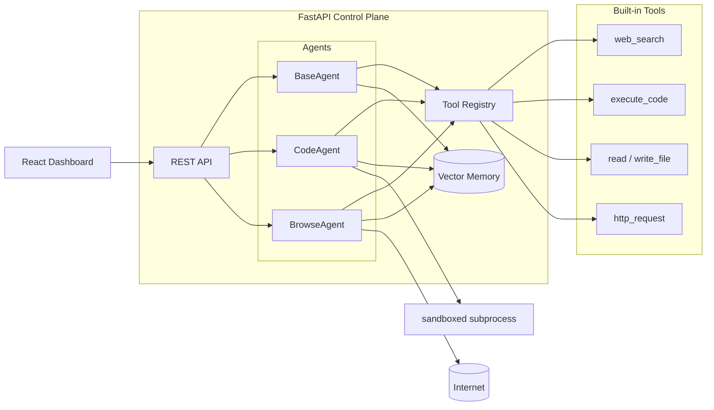

<div align="center">


# AgentOS

**An autonomous AI agent framework — agents that browse, code, and create with tool use and memory.**

[](https://github.com/kamalesh404/AgentOS/actions/workflows/ci.yml)
[](https://www.python.org/)
[](https://github.com/langchain-ai/langgraph)
[](https://fastapi.tiangolo.com/)
[](https://www.docker.com/)
[](https://react.dev/)
[](LICENSE)

</div>

---

## What is AgentOS?

AgentOS turns an LLM into a **self-directing worker**. Give an agent a goal in plain language and it will plan, call tools, observe the results, remember what it learned, and iterate until the job is done — browsing the web, executing code, and managing its own workspace along the way.

## Features

| | |
|---|---|
| **Autonomous agent loop** | A think → act → observe (ReAct) engine with configurable iteration budgets, structured action parsing, and graceful degradation when no LLM key is present |
| **Three agent archetypes** | `BaseAgent` (generalist), `CodeAgent` (writes + executes Python in a sandboxed workspace), `BrowseAgent` (searches the web and synthesizes cited answers) |
| **Pluggable tool registry** | Built-ins for `web_search`, `read_file`, `write_file`, `execute_code`, and `http_request`; register custom HTTP-backed tools at runtime with a single REST call, or toggle any tool per fleet |
| **Vector memory** | Every observation and answer is embedded and stored; recall chronologically or search semantically — OpenAI embeddings with a zero-dependency local hash-embedding fallback |
| **Mission-control dashboard** | React 18 + Vite + Tailwind UI with live fleet status, task runner with execution traces, memory explorer, and a tool console |
| **Production-friendly** | FastAPI + Pydantic v2 typed API, Dockerfile included, CI pipeline covering both backend and frontend |

## Architecture



**The loop:** an agent receives a task, *thinks* (LLM picks a tool + JSON input), *acts* (registry executes it), *observes* (result is embedded into memory), and repeats until it emits `finish`. Every step is traceable through the API.

## Project Structure

```text
AgentOS/
├── backend/
│   ├── agents/
│   │   ├── base_agent.py         # think -> act -> observe engine
│   │   ├── code_agent.py         # sandboxed Python engineering agent
│   │   └── browse_agent.py       # web research agent
│   ├── memory/
│   │   └── store.py              # embedding-backed memory store
│   ├── tools/
│   │   ├── registry.py           # dynamic tool registration + safe execution
│   │   └── builtin_tools.py      # web_search, file I/O, code exec, HTTP
│   ├── main.py                   # FastAPI control plane
│   ├── requirements.txt
│   └── Dockerfile
├── frontend/
│   └── src/
│       ├── components/           # AgentDashboard, TaskRunner, MemoryViewer, ToolRegistry
│       ├── types/index.ts        # shared TypeScript contracts
│       └── App.tsx               # mission-control layout
└── .github/workflows/ci.yml
```

## Getting Started

### Prerequisites

- Python 3.11+
- Node.js 18+
- An `OPENAI_API_KEY` (optional — agents degrade to a deterministic fallback without one)

### Run the backend

```bash
git clone https://github.com/kamalesh404/AgentOS.git
cd AgentOS/backend

pip install -r requirements.txt
export OPENAI_API_KEY="sk-..."
uvicorn main:app --reload --port 8000
```

Interactive Swagger docs are served at [http://localhost:8000/docs](http://localhost:8000/docs).

### Run the frontend

```bash
cd frontend
npm install
npm run dev
```

Open [http://localhost:3000](http://localhost:3000) — the dev server proxies `/api` to port 8000 automatically.

### Or use Docker

```bash
docker build -t agentos-backend ./backend
docker run -p 8000:8000 -e OPENAI_API_KEY=$OPENAI_API_KEY agentos-backend
```

## API Reference

| Method | Endpoint | Description |
|--------|----------|-------------|
| `POST` | `/api/agents/create` | Spawn a new agent (`base`, `code`, or `browse`) |
| `POST` | `/api/agents/{id}/run` | Dispatch a task and get the full execution trace |
| `GET` | `/api/agents/{id}/status` | Live status of one agent |
| `GET` | `/api/agents` | List every agent in the fleet |
| `GET` | `/api/tools` | List registered tools and their schemas |
| `POST` | `/api/tools/register` | Register a custom HTTP-backed tool at runtime |
| `PATCH` | `/api/tools/{name}/toggle?enabled=bool` | Enable or disable a tool |
| `GET` | `/api/memory/{agent_id}` | Recall memories (`?q=` performs semantic search) |

### Examples

```bash
# Spawn a coder agent
curl -X POST http://localhost:8000/api/agents/create \
  -H "Content-Type: application/json" \
  -d '{"type": "code", "name": "knight-coder"}'

# Dispatch a task
curl -X POST http://localhost:8000/api/agents/<agent-id>/run \
  -H "Content-Type: application/json" \
  -d '{"task": "Write and run a Python script that prints the first 20 Fibonacci numbers"}'

# Semantic search over what the agent remembers
curl "http://localhost:8000/api/memory/<agent-id>?q=fibonacci"

# Register your own tool
curl -X POST http://localhost:8000/api/tools/register \
  -H "Content-Type: application/json" \
  -d '{"name": "send_slack", "description": "Post a message to Slack", "url": "https://hooks.slack.com/services/XXX"}'
```

## Configuration

| Variable | Where | Purpose |
|----------|-------|---------|
| `OPENAI_API_KEY` | backend | Enables GPT planning + embeddings; agents degrade gracefully without it |
| `AGENTOS_WORKSPACE` | backend | Root folder for all agent file operations and code execution (defaults to a temp dir) |
| `VITE_API_URL` | frontend | Base URL of the AgentOS API (defaults to same origin) |

## Extending AgentOS

Write a custom archetype by overriding the system prompt and restricting the toolkit:

```python
from agents.base_agent import BaseAgent

class ResearchAnalyst(BaseAgent):
    role = "research analyst"
    default_toolkit = ["web_search", "http_request", "write_file"]

    def system_prompt(self) -> str:
        return self._format_prompt("You are {name}, a meticulous {role}...\n\nAvailable tools:\n{tools}")
```

Or register tools dynamically over REST (see `/api/tools/register`) — agents discover them on their next run.

## Roadmap

- [ ] Multi-agent orchestration graphs via LangGraph
- [ ] Docker-isolated code execution sandboxes
- [ ] Persistent memory backed by pgvector
- [ ] Streaming execution traces over WebSocket
- [ ] Plugin marketplace for community tools

## Contributing

PRs are welcome. The CI pipeline typechecks the frontend and smoke-imports the backend, so keep both green.

## License

Released under the [MIT License](LICENSE).
